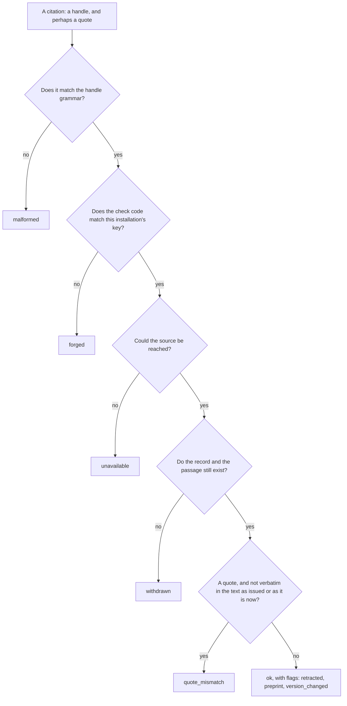
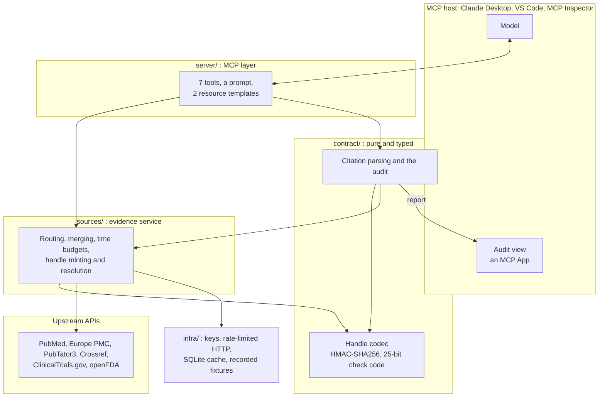

<div align="center">


<a id="tekmeria"></a>

### Citations that can be checked: server-issued handles and a deterministic audit for biomedical evidence

<br/>

<a href="https://pedromarkovicz.github.io/tekmeria/"></a>

<br/><br/>

[](https://github.com/PedroMarkovicz/tekmeria/actions/workflows/ci.yml)
[](https://pypi.org/project/tekmeria/)
[](https://doi.org/10.5281/zenodo.23353865)
[](https://www.python.org/downloads/)
[](https://github.com/modelcontextprotocol/python-sdk)
[](https://docs.pydantic.dev/)
[](https://react.dev/)
[](https://www.typescriptlang.org/)
[](https://github.com/PedroMarkovicz/tekmeria/blob/main/docs/CONTRACT.md)
[](https://github.com/PedroMarkovicz/tekmeria/blob/main/LICENSE)

[Overview](#overview) •
[Quickstart](#quickstart) •
[Results](#results) •
[How a citation works](#how-a-citation-works) •
[Architecture](#architecture) •
[Evaluation](#evaluation) •
[Usage](#usage) •
[Citing](#citing)

</div>

<p align="center">
  <a href="https://pedromarkovicz.github.io/tekmeria/">
    
  </a>
  <br/>
  <em>The audit view on the offline demo: each sentence with its status, each citation with its verdict. The answer fails on a forged and a malformed citation.</em>
</p>

---

<a id="overview"></a>
## Overview

<div align="justify">

Tekmeria is a [Model Context Protocol](https://modelcontextprotocol.io/) server for biomedical evidence from PubMed, Europe PMC, ClinicalTrials.gov and openFDA. Every passage it returns carries a short handle such as `pmid:30831578/abstract.7~ae2tc`, which ends in a check code that only this installation can compute. A model cites those handles, and a deterministic audit then shows which citations are genuine, which point to text that no longer exists, and which quotes are not verbatim. It is meant for people who build or evaluate biomedical question-answering agents, and for developers of MCP hosts who want citations their users can check.

Language models that answer biomedical questions with citations can cite papers that do not exist, misquote the ones that do, and cite retracted work. The problem now reaches the literature itself: an audit of 2.5 million open-access articles found fabricated references in 1 in 2,828 papers in 2023 and in 1 in 277 in early 2026 ([Topaz et al., *The Lancet*, 2026](https://doi.org/10.1016/S0140-6736%2826%2900603-3)). Checks that run after the answer is written must judge whether an imperfect bibliographic match is the right work. Tekmeria moves the guarantee into the tool server. The server that hands out a passage also issues its citation, so a citation is checked against what was issued, not searched for.

> The audit checks provenance and quotation, not support. Whether a passage actually backs its claim is reported as `not_checked`: tekmeria narrows that question to genuine, correctly quoted passages, and leaves it open. A verbatim quote does not settle it: across twelve models, verbatim quotes often failed to support their claims fully ([Zhang et al.](https://arxiv.org/abs/2609.15964)).

</div>

The project stays out of the race for coverage. [BioMCP](https://github.com/genomoncology/biomcp) already reaches about 70 biomedical sources, and retrieval itself helps little: biomedical RAG typically improves on no retrieval by 1 to 2 points ([Nourbakhsh et al.](https://arxiv.org/abs/2606.04127)). Citations are where models fail:
- when asked to cite, the best model in [Ahmed et al.](https://arxiv.org/abs/2604.17114) gave 15.3% relevant PMIDs, most of the rest resolving to real papers in unrelated fields;
- in [Chen et al.](https://arxiv.org/abs/2608.30676), citation fabrication by a medical agent rose from 16.5% to 31.8% when reinforcement learning rewarded only correct answers.

The protocol points the same way: the [2026-07-28 MCP revision](https://modelcontextprotocol.io/specification/2026-07-28/changelog) says that servers needing state across calls use "explicit, server-minted handles passed as ordinary tool arguments".

Others also put trust in the tool rather than the model. An agent runtime can sign a receipt for each tool call and check the claims that cite it ([Basu](https://arxiv.org/abs/2603.10060)); a renderer can mark a number verified only when it matches the record it names ([Solatorio](https://arxiv.org/abs/2509.06902)); and a genome-writing tool layer reachable over MCP requires every quantity to come from a validated tool ([Ali et al.](https://arxiv.org/abs/2608.20412)). Tekmeria applies the idea to citations of biomedical passages: the handle the model writes is itself authenticated, so the server that issued it can check it with its key alone, whichever model or MCP host wrote the answer.

**Status.** Research software, version 0.1.1. The citation contract is versioned separately, at 0.1.0; while it is `0.x`, a breaking change raises its minor version. Changes are listed in [CHANGELOG.md](https://github.com/PedroMarkovicz/tekmeria/blob/main/CHANGELOG.md). A technical note describes the design and the evaluation: [10.5281/zenodo.23374728](https://doi.org/10.5281/zenodo.23374728).

---

<a id="quickstart"></a>
## Quickstart

You need [uv](https://docs.astral.sh/uv/) (it installs a suitable Python if needed). No API keys are required. One command runs the offline demo on recorded responses and opens its audit in your browser:

```bash
uvx tekmeria demo --open
```

To use tekmeria in a chat, add it to an MCP host such as Claude Desktop or VS Code: see [Usage](#usage). The command installs the released package from [PyPI](https://pypi.org/project/tekmeria/). To run the development version instead, use `uvx --from git+https://github.com/PedroMarkovicz/tekmeria tekmeria`, or point `--from` at a local clone.

---

<a id="results"></a>
## Results

<div align="justify">

The evaluation is a conformance test: it plants citations whose correct verdict is known in advance and checks that the audit decides as its specification says. With seed 0 and 25 cases per category:

</div>

| Check | What it measures | Result |
|---|---|---|
| Planted citations | 850 cases in 34 categories, audited as structured claims and as answer text (four categories in one form only) | **1,600 / 1,600** audits correct |
| Whole answers | Every sentence status, every citation, the metrics and the overall verdict of multi-sentence answers | **257 / 257** correct |
| Other seeds | Seeds 1 to 10 at 25 cases per category; seed 0 at 200 (12,800 audits, 1,832 answers) | All correct |
| Injected faults | 38 hand-chosen faults: lenient comparators, lost typographic folds, wrong report rules | **37** caught |
| Mutation analysis | 78 mutants of comparisons, boolean operators and integer constants in the audit's code | **71** killed: 52 by a wrong result, 19 by a crash |
| Live pilot | One question to a frontier model in Claude Desktop; the second of two runs (the first failed on an example handle in the instructions) | 16 / 16 citations issued by the server, 4 / 4 quotes verbatim; `warn`, with 8 of 21 sentences uncited; support not checked |

<div align="justify">

None of this measures how often models fabricate citations, or whether a cited passage supports its sentence. The reference oracle was written by the same author, from the specification and separately from the audit, so it is not independent; whole answers are built from templates; and the faults are chosen by the author. How models cite when they are given handles is left to a later study. The full evaluation, with its output, is [below](#evaluation).

</div>

---

<a id="how-a-citation-works"></a>
## How a citation works

```
pmid:30831578/abstract.7~ae2tc
\__/ \______/ \________/ \___/
scheme  id      path     check code: HMAC of everything before the "~"
```

<div align="justify">

The scheme is one of `pmid`, `pmcid`, `ppr`, `nct` and `setid`; registries that serve only their current version (trials and labels) carry the version that was cited. The model writes `[handle]` after a claim, or `[handle "exact words"]` for numbers and doses. The audit then gives each citation one verdict, from the first check that fails:

</div>



<div align="justify">

The answer as a whole is `fail` if anything in a configurable `fail_on` list occurs (by default, a forged or malformed citation), otherwise `incomplete` if a source could not be reached, otherwise `warn` if any sentence is uncited, any citation is not `ok` or a cited source is retracted, and otherwise `pass`. Each sentence also gets a status: `cited`, `uncited`, or `invalid_only` when none of its citations is `ok`. The report adds metrics, among them citation validity, sentence coverage, quote accuracy and the number of fabricated citations. The full rules are in [docs/CONTRACT.md](https://github.com/PedroMarkovicz/tekmeria/blob/main/docs/CONTRACT.md).

</div>

### Design choices

| Practice | In this project |
|---|---|
| Verify identifiers, not bibliographic similarity | A keyed check code: no title or author matching, no judgement about which work was meant |
| Keep outages apart from fabrication | `unavailable` and `withdrawn` are verdicts of their own, so an outage never counts as fabrication. A copy error that breaks the handle grammar is `malformed`; one that keeps it still reads as `forged` |
| Quote numbers and doses | A quote is compared after Unicode NFC, whitespace collapsing and a fixed list of typographic folds and removed invisible characters, and nothing more lenient |
| Report what is not checked | Every citation carries `support: not_checked` |
| Flag the state of the literature | `retracted`, `preprint` and `version_changed` describe the source without changing the verdict |
| Make the report reproducible | The same input, key, upstream content and cache give the same report, apart from its timestamp |

---

<a id="architecture"></a>
## Architecture

<div align="justify">

The server is a thin MCP layer over an evidence service and a pure citation contract.

</div>



### Layer responsibilities

| Layer | Responsibility |
|---|---|
| **Contract** (`src/tekmeria/contract/`) | The handle codec, the evidence and report models, citation parsing and the audit; pure and fully typed. The JSON Schema in `schemas/` is exported from these models. |
| **Sources** (`src/tekmeria/sources/`) | One adapter per upstream, a parser per record source, and the evidence service, which routes requests, merges sources and resolves handles for the audit. |
| **Infrastructure** (`src/tekmeria/infra/`) | Settings, keys, the rate-limited HTTP client, the SQLite cache and the recorded-fixture transports. |
| **Server** (`src/tekmeria/server/`) | The MCP tools, resources and prompt. The audit view (`src/tekmeria/ui/audit-view.html`) is built from `web/` (React and TypeScript) and committed, so running tekmeria never needs Node. |

<div align="justify">

The design is in [docs/specs](https://github.com/PedroMarkovicz/tekmeria/blob/main/docs/specs/2026-10-06-tekmeria-server-design.md), with the decisions made while building it, and their reasons, in its section 16. [docs/DESIGN.md](https://github.com/PedroMarkovicz/tekmeria/blob/main/docs/DESIGN.md) draws the path from a question to an audited answer, the evaluation, and the path from a push to a release.

</div>

---

<a id="the-demo"></a>
## The demo

`tekmeria demo` runs offline on recorded responses. It searches, fetches two papers, and audits an answer with six planted cases: a correct quote, a misquote, a forged check code, a malformed handle, a citation of a retracted paper and an uncited sentence. This is its audit:

```text
verdict: FAIL  (5 citations: 1 malformed, 1 forged, 1 quote_mismatch, 2 ok)
fabricated: 1  retracted cited: 1  cited sentences: 2/6  verbatim quotes: 1/2
[1] cited: A nationwide Danish cohort found no increased risk of autism after MMR vaccination.
    ok             pmid:30831578/abstract.7~ae2tc "During 5 025 754 person-years of follow-up, 6517 children were diagnosed with autism"
[2] invalid_only: The same study concluded that MMR vaccination raises autism risk.
    quote_mismatch pmid:30831578/abstract.9~wdbv3 "MMR vaccination strongly increases the risk of autism"
                   closest: "MMR vaccination does not increase the risk for autism" (0.8491)
[3] invalid_only: A second cohort reported the same null association.
    forged         pmid:30831578/abstract.7~ae2t0
[4] invalid_only: Earlier reviews reached the same conclusion.
    malformed      pmid:30831578-abstract
[5] cited: A 1998 case series that proposed a link was later retracted.
    ok             pmid:9500320/abstract.4~z567x [retracted]
[6] uncited: Parents should discuss the vaccination schedule with their paediatrician.
```

### In a chat

<div align="justify">

Claude Desktop shows the result of `audit_answer` as the audit view, here for an answer citing a handle this server never issued. The screenshot was taken under the project's first name, which the widget's header shows.

</div>

<p align="center">
  
</p>

### A real run

On 2026-10-07, a model in Claude Desktop answered *"Does MMR vaccination cause autism?"* with the `cite_by_handle` instructions, then audited its own answer:

```text
verdict: WARN  (16 citations: 16 ok)
fabricated: 0  retracted cited: 0  cited sentences: 13/21  verbatim quotes: 4/4
```

<div align="justify">

Every citation was genuine and every quote verbatim. The result is a warning, not a pass, because some sentences had no citation. A first run failed on one forged citation, which turned out to be an example handle in the server's own instructions; it has been removed. Both transcripts, with the full audit output, are in [docs/live-run.md](https://github.com/PedroMarkovicz/tekmeria/blob/main/docs/live-run.md).

</div>

---

<a id="evaluation"></a>
## Evaluation

`tekmeria evaluate` measures the audit's decisions. It plants citations whose correct verdict is known in advance, in 34 categories:
- genuine citations, with verbatim quotes and with quotes written in typographic variants the comparison must accept: spacing, decomposed accents, every dash, apostrophe and quote mark it folds, and the invisible characters it removes;
- quotes with one detail changed: a number, a decimal point, a comparison sign, a unit, a minus sign, a letter's case, an added accent, a superscript digit, a removed space, an inserted "not" or a swapped word;
- forged check codes, paths and record IDs, a forged handle written outside brackets, malformed handles, and a note written inside the citation;
- passages and records that do not exist, and a source that is down;
- retracted papers, preprints and older record versions;
- a forged handle hidden inside an unclosed quote;
- a misquote or a withdrawn record cited beside a genuine citation in the same sentence.

**How the cases are built.**
- They rest on 7 real records (213 passages) from the demo's recorded responses.
- The withdrawn and unavailable cases cite made-up paths, made-up records, and a record treated as unreachable.
- What each case plants is decided by a reference oracle, written from the spec and sharing no code with the audit. It is not independent: the same author wrote both.

**How they are scored.**
- Each case is audited as structured claims and as answer text in one of the citation styles a model might write. The bare-handle and hidden-handle cases run on answer text only, and the two categories that put quote marks inside a quote on structured claims only. The two audits of a case use the same planted citations, so they are not independent observations.
- A case passes only when every citation gets its planted verdict and exactly its planted flags.
- The cases are also written into whole answers of several sentences. A whole answer passes only when every sentence's status, every citation, every metric and the overall verdict come out as planted. Faults in claim status, metrics or the overall verdict leave every citation right, so only whole answers catch them. There are three kinds:
  - mixed: every case, four at a time, with a heading, bold lead-ins and uncited sentences;
  - clean: genuine citations only, which pass;
  - paired: the first case of each category that can be written as answer text (32 of 34) between two sentences that each carry a genuine citation, so its own effect on the overall verdict is scored. A mismatched or withdrawn citation gives `warn`, alone in its sentence or beside a genuine one.
- CI runs the evaluation on pushes to `main` and on pull requests.

Its output, for seed 0 and 25 cases per category:

<details>
<summary>The evaluation's full output: every category, verdict, whole answer and record</summary>

<!-- evaluation:start -->
planted cases: 1600/1600 correct (seed 0, 25 per category; 7 records, 213 passages)
whole answers: 257/257 correct

| Category | Distinct cases | Structured claims | Answer text |
|---|---|---|---|
| `ok_plain` | 25 | 25/25 | 25/25 |
| `ok_quote` | 25 | 25/25 | 25/25 |
| `ok_quote_reformatted` | 25 | 25/25 | 25/25 |
| `ok_quote_apostrophe` | 23 | 25/25 | 25/25 |
| `ok_quote_decomposed` | 2 | 25/25 | 25/25 |
| `ok_quote_double_marks` | 20 | 25/25 | - |
| `ok_quote_folded` | 25 | 25/25 | 25/25 |
| `ok_quote_folded_marks` | 25 | 25/25 | - |
| `ok_quote_invisible` | 25 | 25/25 | 25/25 |
| `quote_number_changed` | 25 | 25/25 | 25/25 |
| `quote_decimal_moved` | 25 | 25/25 | 25/25 |
| `quote_comparison_flipped` | 20 | 25/25 | 25/25 |
| `quote_unit_changed` | 25 | 25/25 | 25/25 |
| `quote_sign_changed` | 25 | 25/25 | 25/25 |
| `quote_case_changed` | 25 | 25/25 | 25/25 |
| `quote_accent_added` | 25 | 25/25 | 25/25 |
| `quote_compatibility_form` | 25 | 25/25 | 25/25 |
| `quote_space_removed` | 25 | 25/25 | 25/25 |
| `quote_negated` | 25 | 25/25 | 25/25 |
| `quote_word_swapped` | 25 | 25/25 | 25/25 |
| `forged_check_code` | 25 | 25/25 | 25/25 |
| `forged_path_swap` | 25 | 25/25 | 25/25 |
| `forged_record_id` | 25 | 25/25 | 25/25 |
| `forged_bare` | 25 | - | 25/25 |
| `malformed` | 25 | 25/25 | 25/25 |
| `malformed_with_note` | 25 | 25/25 | 25/25 |
| `withdrawn_path` | 25 | 25/25 | 25/25 |
| `withdrawn_record` | 25 | 25/25 | 25/25 |
| `unavailable` | 9 | 25/25 | 25/25 |
| `retracted_cited` | 5 | 25/25 | 25/25 |
| `preprint_cited` | 2 | 25/25 | 25/25 |
| `version_changed` | 25 | 25/25 | 25/25 |
| `hidden_in_quote` | 25 | - | 25/25 |
| `invalid_beside_valid` | 25 | 25/25 | 25/25 |

| Verdict | Planted | Given | Precision | Recall |
|---|---|---|---|---|
| `malformed` | 100 | 100 | 1.000 | 1.000 |
| `forged` | 200 | 200 | 1.000 | 1.000 |
| `unavailable` | 50 | 50 | 1.000 | 1.000 |
| `withdrawn` | 124 | 124 | 1.000 | 1.000 |
| `quote_mismatch` | 601 | 601 | 1.000 | 1.000 |
| `ok` | 600 | 600 | 1.000 | 1.000 |

| Whole answers | Correct | Planted overall verdicts |
|---|---|---|
| mixed | 200/200 | `fail` 128, `incomplete` 15, `warn` 57 |
| clean | 25/25 | `pass` 25 |
| paired | 32/32 | `fail` 7, `incomplete` 1, `pass` 9, `warn` 15 |

| Record | Planted citations |
|---|---|
| nct:NCT04363697 | 188 |
| outside the snapshot | 87 |
| pmcid:PMC12585062 | 139 |
| pmid:30831578 | 25 |
| pmid:41187138 | 10 |
| pmid:9500320 | 25 |
| ppr:PPR1297067 | 25 |
| setid:7c4deb97-9966-4c8e-9ba6-bb260b71e130 | 401 |
<!-- evaluation:end -->

</details>

**Options.** `--seed` (default 0) and `--per-category` (default 25) choose the cases, and `--json-out` writes the full report, with the confusion matrix.

**How to read it.**
- Small pools are drawn from more than once: see "Distinct cases".
- The drug label and the trial supply most planted citations: see the last table.
- The evaluation shows that the audit decides correctly on these planted errors. It does not show how often models make such errors: that takes runs with real models, like the one above.

**Injected faults.** `python -m tekmeria.evaluation.faults` breaks one decision of the audit at a time, as a real bug would, and reruns the evaluation. Its 38 faults are chosen by hand:
- lenient comparators: case, punctuation, accents, whitespace, NFKC, or only the first 40 characters;
- each of 19 folds of the contract removed in turn, and a no-break space not read as whitespace (deleting that fold entry itself changes nothing, since whitespace normalization already reads it as a space);
- each of the 4 invisible characters no longer removed;
- a check code that ignores the path, dropped flags, and wrong rules for claim status, coverage, validity and the overall verdict, among them the two earlier rules under which a sentence cited only by invalid citations, or an invalid citation beside a valid one, did not warn.

It catches 37 of them. The one it misses is listed with its reason: no passage of the snapshot contains an ellipsis, so the ellipsis fold cannot be planted. CI runs it with 10 cases per category, enough for every dash and quote mark to appear.

**Mutation score.** `python -m tekmeria.evaluation.mutants` is less selective. It makes one small change at a time in the audit's code (the citation parser, the handle codec, the quote comparison and the audit itself) and runs the evaluation against each one. A change negates a comparison or moves it across its boundary, swaps `and` and `or`, removes a `not`, flips a boolean, or adds one to an integer. String and regular-expression constants are not changed, so the score says little about the citation grammar or the fold table: the injected faults cover those.
- The evaluation kills 71 of 78 changes: 52 by a wrong result and 19 by a crash.
- One more change stops the snapshot from loading, so the evaluation never judges it, and it is left out of the score.
- Three of the seven survivors change nothing for any record the current source parsers can build: two in the `preprint` rule, whose two signals the parsers always set together, and one in the handling of bold lead-ins, whose effect a later step removes.
- The remaining four are faults it misses: `checked_against`, which it does not score; an empty quote (two changes); and the text of a plain `[1]` bracket.
- Outside its scope, so never changed: the diagnostic `closest_match`, the `check_handles` tool, the key-length check, the cursor signature, and the record-ID parsing and passage addressing that only the evidence service uses.

Some categories rest on few passages: one passage has an accented letter, so the decomposed-accent category tests a single character.

---

<a id="usage"></a>
## Usage

The [quickstart](#quickstart) runs the offline demo. To use tekmeria in a chat, add it to an MCP host:

<details>
<summary>Claude Desktop, VS Code and MCP Inspector</summary>

### Claude Desktop

Add this to `claude_desktop_config.json` (Settings, Developer, Edit Config) and restart:

```json
{
  "mcpServers": {
    "tekmeria": {
      "command": "uvx",
      "args": ["tekmeria"]
    }
  }
}
```

Then start a chat with the `cite_by_handle` prompt. `audit_answer` also declares the audit view (`ui://tekmeria/audit-view`) as an MCP App, for hosts that support MCP Apps.

### VS Code

Add this to `.vscode/mcp.json`:

```json
{
  "servers": {
    "tekmeria": {
      "type": "stdio",
      "command": "uvx",
      "args": ["tekmeria"]
    }
  }
}
```

### MCP Inspector

```bash
npx @modelcontextprotocol/inspector uvx tekmeria
```

</details>

### Commands

| Command | What it does |
|---|---|
| `tekmeria` | Serves MCP over stdio. |
| `tekmeria --http --port 8000` | Serves Streamable HTTP on `http://127.0.0.1:8000/mcp` (localhost only). |
| `tekmeria --demo` | Serves the recorded demo data with the public demo key: no network needed. |
| `tekmeria demo` | Runs the offline demo and prints the audit. Add `--json-out PATH` for the report, `--html-out PATH` for the audit view, `--open` to open it. |

### Configuration

Everything is optional and read from environment variables; a `.env` file is not read.

<details>
<summary>The eight environment variables</summary>

| Variable | Use |
|---|---|
| `NCBI_API_KEY` | Raises the PubMed limit from 3 to 10 requests per second. |
| `NCBI_EMAIL` | Contact address NCBI asks for; sent only when set. |
| `OPENFDA_API_KEY` | Raises openFDA's daily limit from 1,000 to 120,000 requests. |
| `CROSSREF_MAILTO` | Puts Crossref requests in its polite pool; sent only when set. |
| `TEKMERIA_HANDLE_KEY` | The handle key, in hex: at least 32 bytes (64 hex digits). By default a random key is created on first run and stored in your user data folder. |
| `TEKMERIA_CACHE_PATH` | Where the SQLite cache lives (default: your user cache folder). |
| `TEKMERIA_LOG_LEVEL` | Log level for the JSON logs on stderr (default `INFO`). |
| `TEKMERIA_TOOL_DEADLINE_S` | Seconds each tool call may take (default 45). |

</details>

### Tools

| Tool | What it does |
|---|---|
| `search_literature` | Searches PubMed and Europe PMC (preprints included), merged without duplicates. Filters: dates, study designs, peer review, open access, retractions. |
| `search_trials` | Searches ClinicalTrials.gov by condition, intervention or terms; filters by status, phase and posted results. |
| `search_drug_labels` | Finds every openFDA drug label naming a drug, newest first. |
| `fetch_passages` | Fetches records (`pmid:`, `pmcid:`, `ppr:`, `nct:`, `setid:`) and their passages, each with a handle; adds entities and retraction status. |
| `resolve_handles` | Looks up the passage behind each handle and says whether the handle is genuine. |
| `audit_answer` | Audits an answer's citations and returns the report; declares the audit view (`ui://tekmeria/audit-view`) as an MCP App. |
| `describe_contract` | Returns the contract: handle grammar, verdicts, flags, metrics and the citing instructions. |

There is also a prompt, `cite_by_handle`, and two resource templates, `evidence://record/{+record_id}` and `evidence://passage/{+handle}` (the `+` lets the slashes in a handle through).

---

<a id="development"></a>
## Development

### How it is checked

```bash
uv sync
uv run pytest            # Python tests, offline (recorded fixtures)
uv run ruff check && uv run ruff format --check && uv run pyright
uv run pytest -m live    # smoke tests against the real APIs
```

The audit view:

```bash
cd web
npm ci
npm test && npm run typecheck
npm run build            # rewrites src/tekmeria/ui/audit-view.html; commit it
```

<div align="justify">

After changing the report models, run `uv run python -m tekmeria.contract.schemas`. To re-record the fixtures from the live APIs, delete `src/tekmeria/demo/fixtures/*.json` and run `uv run tekmeria record-fixtures` (with no email or API keys set). The recorder keeps third-party text to what the demo, the tests and the evaluation use: it records a CC BY open-access article, removes from search results every abstract that is not CC BY or CC0, and keeps PubMed abstracts only for the records the demo, the tests and the evaluation fetch and for search results Europe PMC lists as CC BY or CC0 (see [NOTICE](https://github.com/PedroMarkovicz/tekmeria/blob/main/NOTICE)).

Publishing a GitHub release runs `.github/workflows/release.yml`: it checks that CI passed on the tagged commit, that the tag names the package version, that `server.json` is valid and that the demo page this README links to is live, runs the tests and builds the package. Once the maintainer approves it in the `pypi` environment, it publishes the package to PyPI by trusted publishing and then lists the new version in the [MCP Registry](https://registry.modelcontextprotocol.io/); both sign in with the workflow's GitHub identity, so no token is stored anywhere.

</div>

### The repository

| Path | What is there |
|---|---|
| [src/tekmeria/](https://github.com/PedroMarkovicz/tekmeria/tree/main/src/tekmeria) | the server, the citation contract, the evidence sources, the evaluation and the offline demo |
| [web/](https://github.com/PedroMarkovicz/tekmeria/tree/main/web) | the audit view: React and TypeScript, built into one committed HTML file |
| [tests/](https://github.com/PedroMarkovicz/tekmeria/tree/main/tests) | offline tests on recorded responses, and live smoke tests |
| [docs/](https://github.com/PedroMarkovicz/tekmeria/tree/main/docs) | the [contract](https://github.com/PedroMarkovicz/tekmeria/blob/main/docs/CONTRACT.md), the [design and its decisions](https://github.com/PedroMarkovicz/tekmeria/blob/main/docs/specs/2026-10-06-tekmeria-server-design.md), the [acceptance criteria](https://github.com/PedroMarkovicz/tekmeria/blob/main/docs/ACCEPTANCE.md) and the [live runs](https://github.com/PedroMarkovicz/tekmeria/blob/main/docs/live-run.md) |
| [schemas/](https://github.com/PedroMarkovicz/tekmeria/tree/main/schemas) | the JSON Schema of the report, exported from the models |

---

<a id="limits"></a>
## What it cannot tell you

- **Whether a passage supports its sentence.** The audit checks that a citation was issued by this server, that its passage still exists, and that any quote is verbatim (in the text as issued or as it is now). Support is not checked.
- **Medical advice.** Tekmeria retrieves and audits evidence; it does not judge it, and nothing it returns is clinical guidance. It queries public biomedical APIs and is not built for patient data.
- **Old versions of registries.** ClinicalTrials.gov and openFDA serve only the current version of a record; an older cited version is flagged `version_changed`, but its old text can come only from tekmeria's cache.
- **A handle from another installation.** A handle verifies only on the installation (key) that issued it.
- **PubMed book chapters.** Records such as StatPearls or GeneReviews chapters are left out of searches, and fetching one reports it as not found.
- **A deduplicated stream across pages.** `search_literature` never shows the same record twice on one page, but a record can reappear on a later page.

---

<a id="contributing"></a>
## Contributing and support

- **A problem or a question:** open an [issue](https://github.com/PedroMarkovicz/tekmeria/issues). For a wrong verdict, include the answer text you audited and the report; a handle verifies only on the installation that issued it, so say whether you used the demo key.
- **A vulnerability:** report it privately, through the repository's Security tab, as [SECURITY.md](https://github.com/PedroMarkovicz/tekmeria/blob/main/SECURITY.md) describes.
- **A change:** pull requests are welcome. [CONTRIBUTING.md](https://github.com/PedroMarkovicz/tekmeria/blob/main/CONTRIBUTING.md) lists the checks to run and what a change needs; a change to what the audit decides needs a case in the evaluation.
- **A rights holder** who wants a recorded item removed can open an issue, as [NOTICE](https://github.com/PedroMarkovicz/tekmeria/blob/main/NOTICE) says.

---

<a id="citing"></a>
## Citing

<div align="justify">

To cite tekmeria, use the metadata in [CITATION.cff](https://github.com/PedroMarkovicz/tekmeria/blob/main/CITATION.cff); GitHub's "Cite this repository" button formats it. Releases are archived on Zenodo: [10.5281/zenodo.23353865](https://doi.org/10.5281/zenodo.23353865) always resolves to the latest release, and version 0.1.1 is [10.5281/zenodo.23376855](https://doi.org/10.5281/zenodo.23376855). [Software Heritage](https://www.softwareheritage.org/) archives the full history; release 0.1.0 is [swh:1:rel:9d852cbc58c0adc8919be14723b074d6dd5b7b45](https://archive.softwareheritage.org/swh:1:rel:9d852cbc58c0adc8919be14723b074d6dd5b7b45;origin=https://github.com/PedroMarkovicz/tekmeria). Changes between releases are in [CHANGELOG.md](https://github.com/PedroMarkovicz/tekmeria/blob/main/CHANGELOG.md).

</div>

```bibtex
@software{markovicz_tekmeria,
  author  = {Markovicz, Pedro},
  title   = {tekmeria},
  note    = {Server-issued citation handles and a deterministic audit for biomedical evidence},
  version = {0.1.1},
  year    = {2026},
  doi     = {10.5281/zenodo.23376855},
  url     = {https://github.com/PedroMarkovicz/tekmeria},
  license = {Apache-2.0}
}
```

<div align="justify">

To cite the design or the evaluation, cite the technical note. It is archived on Zenodo as a preprint: [10.5281/zenodo.23374728](https://doi.org/10.5281/zenodo.23374728) always resolves to its latest version, and version 1 is [10.5281/zenodo.23374729](https://doi.org/10.5281/zenodo.23374729).

</div>

```bibtex
@misc{markovicz_tekmeria_note,
  author    = {Markovicz, Pedro},
  title     = {Tekmeria: Server-Issued Citation Handles and a Deterministic Audit for Biomedical {LLM} Answers},
  year      = {2026},
  publisher = {Zenodo},
  note      = {Preprint, version 1},
  doi       = {10.5281/zenodo.23374729}
}
```

---

## Data and licence

<div align="justify">

Code: Apache License 2.0; see [LICENSE](https://github.com/PedroMarkovicz/tekmeria/blob/main/LICENSE) and [NOTICE](https://github.com/PedroMarkovicz/tekmeria/blob/main/NOTICE).

The recorded API responses under `src/tekmeria/demo/fixtures/` keep the terms of their sources, listed in NOTICE: United States government data from ClinicalTrials.gov and openFDA, bibliographic records from PubMed, Europe PMC and Crossref, a CC BY 4.0 full-text article and a CC BY 4.0 preprint, both credited there.

Tekmeria relies on the public APIs of the National Library of Medicine (PubMed, PubTator3 and ClinicalTrials.gov), Europe PMC, the Food and Drug Administration (openFDA) and Crossref. It is not affiliated with or endorsed by any of them.

</div>

---

<div align="center">

**Built with ☕ and a healthy distrust of unverifiable citations**

[⬆ Back to top](#tekmeria)

</div>

<!-- mcp-name: io.github.PedroMarkovicz/tekmeria -->
