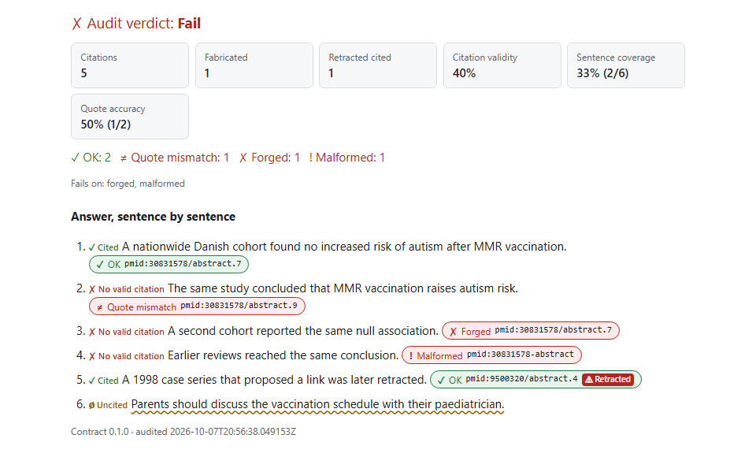
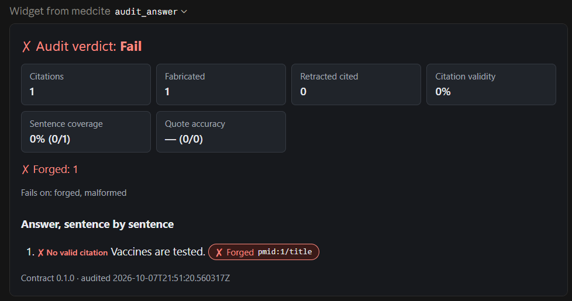

# tekmerion

Biomedical evidence over MCP, cited by handle. Every passage tekmerion returns comes with a short handle such as `pmid:30831578/abstract.7~30med`. An agent cites those handles, and a deterministic audit then shows, for any model, which citations are genuine, which point to text that no longer exists, and which quotes are not verbatim.



Once GitHub Pages is enabled for the repository, running the `pages` workflow (`.github/workflows/pages.yml`) publishes this view of the demo to <https://pedromarkovicz.github.io/tekmerion/>.

## Why

- **More sources would not set this apart.** [BioMCP](https://github.com/genomoncology/biomcp) (MIT) already reaches dozens of biomedical sources.
- **Better retrieval barely helps.** Nourbakhsh et al. ([*When Retrieval Doesn't Help*](https://arxiv.org/abs/2606.04127)) found biomedical RAG improves on no retrieval by typically 1–2 points; the choice of model matters far more.
- **Citations are where models fail.**
  - When explicitly asked to cite, the best model in Ahmed et al. ([arXiv 2604.17114](https://arxiv.org/abs/2604.17114)) produced 15.3% relevant PMIDs; most of the rest resolved to real papers in unrelated fields.
  - In Chen et al. ([arXiv 2608.30676](https://arxiv.org/abs/2608.30676)), citation fabrication by a medical agent rose from 16.5% to 31.8% when reinforcement learning rewarded only correct answers, even as accuracy improved.
- **MCP now points this way.** The [2026-07-28 MCP revision](https://modelcontextprotocol.io/specification/2026-07-28/changelog) makes the protocol stateless and says that servers needing state across calls use "explicit, server-minted handles passed as ordinary tool arguments".

So tekmerion does not compete on coverage. It makes every citation checkable.

## How it works

```
pmid:30831578/abstract.7~30med
\__/ \______/ \________/ \___/
scheme  id      path     check code: HMAC of everything before the "~"
```

1. **Search and fetch.** The tools return records and passages from PubMed, Europe PMC (with preprints and open-access full text), ClinicalTrials.gov and openFDA drug labels, enriched with PubTator3 entities and Crossref retraction status. Every passage carries its handle.
2. **Answer.** The model writes its answer with citations in brackets: `[handle]`, or `[handle "exact words"]` for numbers and doses.
3. **Audit.** `audit_answer` checks each citation, in this order: is the handle well formed, did this server issue it, can its source be reached, does the passage still exist, and is the quote verbatim? It reports a verdict per citation, a status per sentence, metrics such as the number of fabricated citations, and an overall `pass`, `warn`, `fail` or `incomplete`.

The audit checks integrity, not support: whether a passage actually backs the claim is reported as `not_checked`. [docs/CONTRACT.md](docs/CONTRACT.md) has the full rules.

## Quickstart

You need [uv](https://docs.astral.sh/uv/) (it installs a suitable Python if needed). No API keys are required. While the repository is private, `uvx --from git+https://...` needs your GitHub credentials (Git Credential Manager provides them); you can also point `--from` at a local clone.

See the audit on the offline demo, in the terminal and in your browser:

```bash
uvx --from git+https://github.com/PedroMarkovicz/tekmerion tekmerion demo --open
```

### Claude Desktop

Add this to `claude_desktop_config.json` (Settings, Developer, Edit Config) and restart:

```json
{
  "mcpServers": {
    "tekmerion": {
      "command": "uvx",
      "args": ["--from", "git+https://github.com/PedroMarkovicz/tekmerion", "tekmerion"]
    }
  }
}
```

Then start a chat with the `cite_by_handle` prompt. `audit_answer` also declares the audit view (`ui://tekmerion/audit-view`) as an MCP App, for hosts that support MCP Apps.

### VS Code

Add this to `.vscode/mcp.json`:

```json
{
  "servers": {
    "tekmerion": {
      "type": "stdio",
      "command": "uvx",
      "args": ["--from", "git+https://github.com/PedroMarkovicz/tekmerion", "tekmerion"]
    }
  }
}
```

### MCP Inspector

```bash
npx @modelcontextprotocol/inspector uvx --from git+https://github.com/PedroMarkovicz/tekmerion tekmerion
```

### Other ways to run it

| Command | What it does |
|---|---|
| `tekmerion` | Serves MCP over stdio. |
| `tekmerion --http --port 8000` | Serves Streamable HTTP on `http://127.0.0.1:8000/mcp` (localhost only). |
| `tekmerion --demo` | Serves the recorded demo data with the public demo key: no network needed. |
| `tekmerion demo` | Runs the offline demo and prints the audit. Add `--json-out PATH` for the report, `--html-out PATH` for the audit view, `--open` to open it. |

### Configuration

Everything is optional and read from environment variables; a `.env` file is not read:

| Variable | Use |
|---|---|
| `NCBI_API_KEY` | Raises the PubMed limit from 3 to 10 requests per second. |
| `NCBI_EMAIL` | Contact address NCBI asks for; sent only when set. |
| `OPENFDA_API_KEY` | Raises openFDA's daily limit from 1,000 to 120,000 requests. |
| `CROSSREF_MAILTO` | Puts Crossref requests in its polite pool; sent only when set. |
| `TEKMERION_HANDLE_KEY` | The handle key, in hex: at least 32 bytes (64 hex digits). By default a random key is created on first run and stored in your user data folder. |
| `TEKMERION_CACHE_PATH` | Where the SQLite cache lives (default: your user cache folder). |
| `TEKMERION_LOG_LEVEL` | Log level for the JSON logs on stderr (default `INFO`). |
| `TEKMERION_TOOL_DEADLINE_S` | Seconds each tool call may take (default 45). |

## Tools

| Tool | What it does |
|---|---|
| `search_literature` | Searches PubMed and Europe PMC (preprints included), merged without duplicates. Filters: dates, study designs, peer review, open access, retractions. |
| `search_trials` | Searches ClinicalTrials.gov by condition, intervention or terms; filters by status, phase and posted results. |
| `search_drug_labels` | Finds every openFDA drug label naming a drug, newest first. |
| `fetch_passages` | Fetches records (`pmid:`, `pmcid:`, `ppr:`, `nct:`, `setid:`) and their passages, each with a handle; adds entities and retraction status. |
| `resolve_handles` | Looks up the passage behind each handle and says whether the handle is genuine. |
| `audit_answer` | Audits an answer's citations and returns the report; declares the audit view (`ui://tekmerion/audit-view`) as an MCP App. |
| `describe_contract` | Returns the contract: handle grammar, verdicts, flags, metrics and the citing instructions. |

There is also a prompt, `cite_by_handle`, and two resource templates, `evidence://record/{+record_id}` and `evidence://passage/{+handle}` (the `+` lets the slashes in a handle through).

## The demo

`tekmerion demo` runs offline on recorded responses. It searches, fetches two papers, and audits an answer with six planted cases: a correct quote, a misquote, a forged check code, a malformed handle, a citation of a retracted paper and an uncited sentence. This is its audit:

```text
verdict: FAIL  (5 citations: 1 malformed, 1 forged, 1 quote_mismatch, 2 ok)
fabricated: 1  retracted cited: 1  cited sentences: 2/6  verbatim quotes: 1/2
[1] cited: A nationwide Danish cohort found no increased risk of autism after MMR vaccination.
    ok             pmid:30831578/abstract.7~30med "During 5 025 754 person-years of follow-up, 6517 children were diagnosed with autism"
[2] invalid_only: The same study concluded that MMR vaccination raises autism risk.
    quote_mismatch pmid:30831578/abstract.9~2h68h "MMR vaccination strongly increases the risk of autism"
                   closest: "MMR vaccination does not increase the risk for autism" (0.8491)
[3] invalid_only: A second cohort reported the same null association.
    forged         pmid:30831578/abstract.7~30me0
[4] invalid_only: Earlier reviews reached the same conclusion.
    malformed      pmid:30831578-abstract
[5] cited: A 1998 case series that proposed a link was later retracted.
    ok             pmid:9500320/abstract.4~ewr8d [retracted]
[6] uncited: Parents should discuss the vaccination schedule with their paediatrician.
```

## In a chat

Claude Desktop shows the result of `audit_answer` as the audit view, here for an answer citing a handle this server never issued. The screenshot was taken before the rename, so the widget's header shows the project's earlier name:



## A real run

On 2026-10-07, a model in Claude Desktop answered *"Does MMR vaccination cause autism?"* with the `cite_by_handle` instructions, then audited its own answer:

```text
verdict: WARN  (16 citations: 16 ok)
fabricated: 0  retracted cited: 0  cited sentences: 13/21  verbatim quotes: 4/4
```

Every citation was genuine and every quote verbatim. The result is a warning, not a pass, because some sentences had no citation. A first run failed on one forged citation, which turned out to be an example handle in the server's own instructions; it has been removed. Both transcripts, with the full audit output, are in [docs/live-run.md](docs/live-run.md).

## Evaluation

`tekmerion evaluate` measures the audit's decisions. It plants citations whose correct verdict is known in advance, in 17 categories:
- genuine citations, with verbatim or reformatted quotes;
- quotes with a changed number, an inserted "not" or a swapped word;
- forged check codes, paths and record IDs, and malformed handles;
- passages and records that do not exist, and a source that is down;
- retracted papers, preprints and older record versions;
- a forged handle hidden inside an unclosed quote.

**How the cases are built.**
- They rest on 7 real records (178 passages) from the demo's recorded responses.
- The withdrawn and unavailable cases cite made-up paths, made-up records, and a record treated as unreachable.
- What each case plants is decided by a reference oracle, written from the spec and sharing no code with the audit.

**How they are scored.**
- Each case is audited as structured claims and, except the hidden-handle case, also as answer text in one of the citation styles a model might write. The two audits of a case use the same planted citations, so they are not independent observations.
- A case passes only when every citation gets its planted verdict and exactly its planted flags.
- CI runs the evaluation on every push.

This is its output:

<!-- evaluation:start -->
planted cases: 825/825 correct (seed 0, 25 per category; 7 records, 178 passages)

| Category | Distinct cases | Structured claims | Answer text |
|---|---|---|---|
| `ok_plain` | 25 | 25/25 | 25/25 |
| `ok_quote` | 25 | 25/25 | 25/25 |
| `ok_quote_reformatted` | 25 | 25/25 | 25/25 |
| `quote_number_changed` | 25 | 25/25 | 25/25 |
| `quote_negated` | 25 | 25/25 | 25/25 |
| `quote_word_swapped` | 25 | 25/25 | 25/25 |
| `forged_check_code` | 25 | 25/25 | 25/25 |
| `forged_path_swap` | 25 | 25/25 | 25/25 |
| `forged_record_id` | 25 | 25/25 | 25/25 |
| `malformed` | 25 | 25/25 | 25/25 |
| `withdrawn_path` | 25 | 25/25 | 25/25 |
| `withdrawn_record` | 25 | 25/25 | 25/25 |
| `unavailable` | 9 | 25/25 | 25/25 |
| `retracted_cited` | 5 | 25/25 | 25/25 |
| `preprint_cited` | 2 | 25/25 | 25/25 |
| `version_changed` | 25 | 25/25 | 25/25 |
| `hidden_in_quote` | 25 | - | 25/25 |

| Verdict | Planted | Given | Precision | Recall |
|---|---|---|---|---|
| `malformed` | 50 | 50 | 1.000 | 1.000 |
| `forged` | 175 | 175 | 1.000 | 1.000 |
| `unavailable` | 50 | 50 | 1.000 | 1.000 |
| `withdrawn` | 100 | 100 | 1.000 | 1.000 |
| `quote_mismatch` | 175 | 175 | 1.000 | 1.000 |
| `ok` | 300 | 300 | 1.000 | 1.000 |

| Record | Planted citations |
|---|---|
| nct:NCT04363697 | 94 |
| outside the snapshot | 75 |
| pmcid:PMC13425182 | 16 |
| pmid:30831578 | 15 |
| pmid:42530928 | 2 |
| pmid:9500320 | 25 |
| ppr:PPR1297067 | 25 |
| setid:7c4deb97-9966-4c8e-9ba6-bb260b71e130 | 198 |
<!-- evaluation:end -->

**Options.** `--seed` (default 0) and `--per-category` (default 25) choose the cases, and `--json-out` writes the full report, with the confusion matrix.

**How to read it.**
- Small pools are drawn from more than once: see "Distinct cases".
- The drug label and the trial supply most planted citations: see the last table.
- The evaluation shows that the audit decides correctly on these planted errors. It does not show how often models make such errors: that takes runs with real models, like the one above.

## Architecture

```
  PubMed   Europe PMC   PubTator3   Crossref   ClinicalTrials.gov   openFDA
     \          |            |          |               |              /
      +------------------- sources/: one adapter per upstream -------+
                              |   (rate limits, validation, cache)
                       EvidenceService: routing, merging, time budgets,
                              |   handle minting, handle resolution
                     contract/: handles, models, citation parsing, audit
                              |
                 server/: MCP tools, resources, prompt, audit view (ui://)
```

- `src/tekmerion/contract/` is pure and fully typed: the handle codec, the evidence and report models, citation parsing and the audit. The JSON Schema in `schemas/` is exported from these models.
- `src/tekmerion/sources/` has one adapter per upstream, a parser for each record source (PubMed, Europe PMC, ClinicalTrials.gov and openFDA), and `service.py`, which routes requests, merges sources and resolves handles for the audit.
- `src/tekmerion/infra/` holds settings, keys, the rate-limited HTTP client, the SQLite cache and the recorded-fixture transports.
- `src/tekmerion/server/` is the thin MCP layer; `src/tekmerion/ui/audit-view.html` is the audit view, built from `web/` (React and TypeScript) and committed, so running tekmerion never needs Node.

The design is in [docs/specs](docs/specs/2026-10-06-tekmerion-server-design.md), with the decisions made while building it in its section 16.

## Development

```bash
uv sync
uv run pytest            # Python tests, offline (recorded fixtures)
uv run ruff check && uv run ruff format --check && uv run pyright
uv run pytest -m live    # smoke tests against the real APIs
```

The audit view:

```bash
cd web
npm ci
npm test && npm run typecheck
npm run build            # rewrites src/tekmerion/ui/audit-view.html; commit it
```

After changing the report models, run `uv run python -m tekmerion.contract.schemas`. To re-record the fixtures from the live APIs, delete `src/tekmerion/demo/fixtures/*.json` and run `uv run tekmerion record-fixtures` (with no email or API keys set).

[docs/ACCEPTANCE.md](docs/ACCEPTANCE.md) tracks the acceptance criteria and how each one is checked.

## Limits

- **Not medical advice.** tekmerion retrieves and audits evidence; it does not judge it, and nothing it returns is clinical guidance.
- **Public data only.** It queries public biomedical APIs and is not built for patient data.
- **Integrity, not support.** The audit checks that a citation was issued by this server, that its passage still exists, and that any quote is verbatim (in the text as issued or as it is now). Whether the passage supports the sentence is not checked.
- **Current versions only.** ClinicalTrials.gov and openFDA serve only the current version of a record; an older cited version is flagged `version_changed`, but its old text can come only from tekmerion's cache.
- **Handles are per installation.** A handle verifies only on the installation (key) that issued it.
- **No PubMed book chapters yet.** Records such as StatPearls or GeneReviews chapters are left out of searches, and fetching one reports it as not found.
- **Duplicates are merged page by page.** `search_literature` never shows the same record twice on one page, but a record can reappear on a later page.

## License

Apache License 2.0; see [LICENSE](LICENSE) and [NOTICE](NOTICE).
