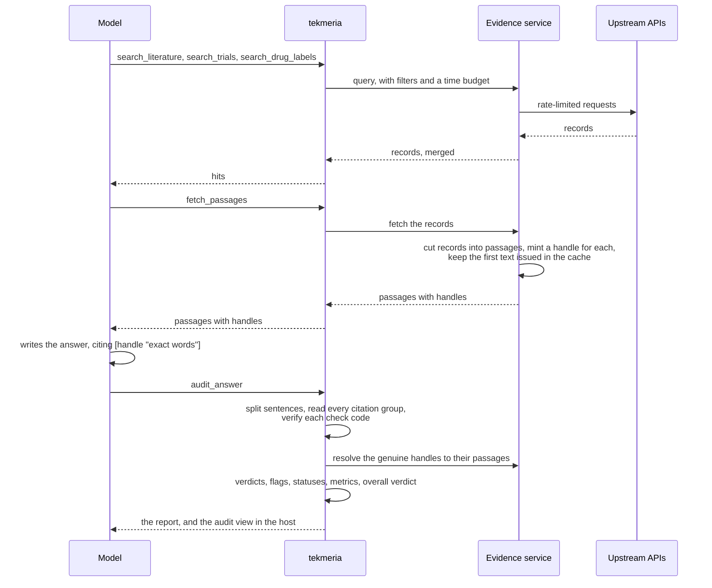
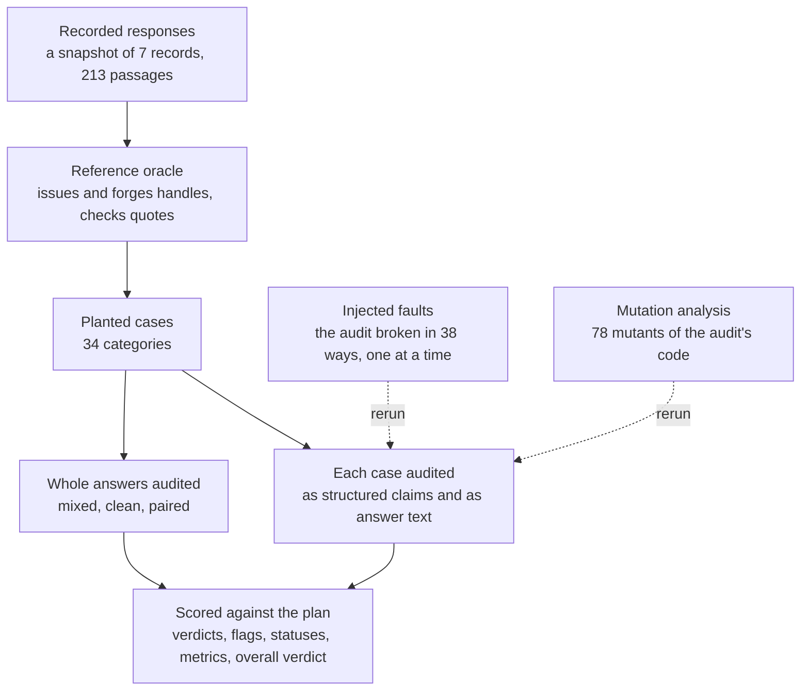
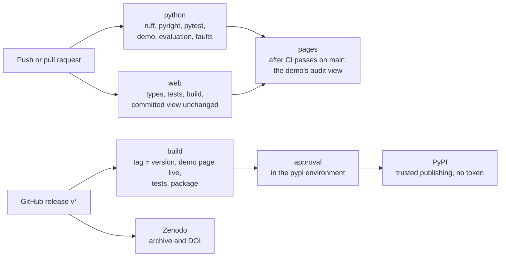

# Low-level design

Three diagrams of how tekmeria works. The [README](../README.md) has the architecture and the order of the audit's checks, and the [design document](specs/2026-10-06-tekmeria-server-design.md) records the decisions and their reasons.

## From a question to an audited answer

## The evaluation

## From a push to a release

